# 3D-printable enclosure for USBCANFD DUAL: M3 screws + heat-set inserts

An alternative enclosure for the **USBCANFD DUAL** (2-channel CAN FD) adapter. It is held together by four M3 screws in brass heat-set inserts instead of snap-fits. It has light pipes for the status LEDs, a reset button, removable termination-jumper holders and two-colour labels.

The geometry is built from scratch in FreeCAD by a Python script ([`source/build_cannectivity_case.py`](source/build_cannectivity_case.py)). PCB dimensions and component positions are taken from the DXF in the original `USBCANFD_DUAL_SOLO.FCStd` (`3DBox_for_adaptersSOLO_DUAL.zip`). The design was printed and tested on a Bambu Lab P2S in PETG.

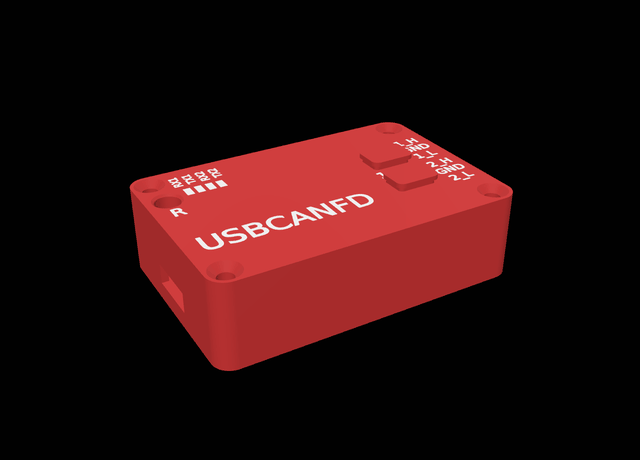

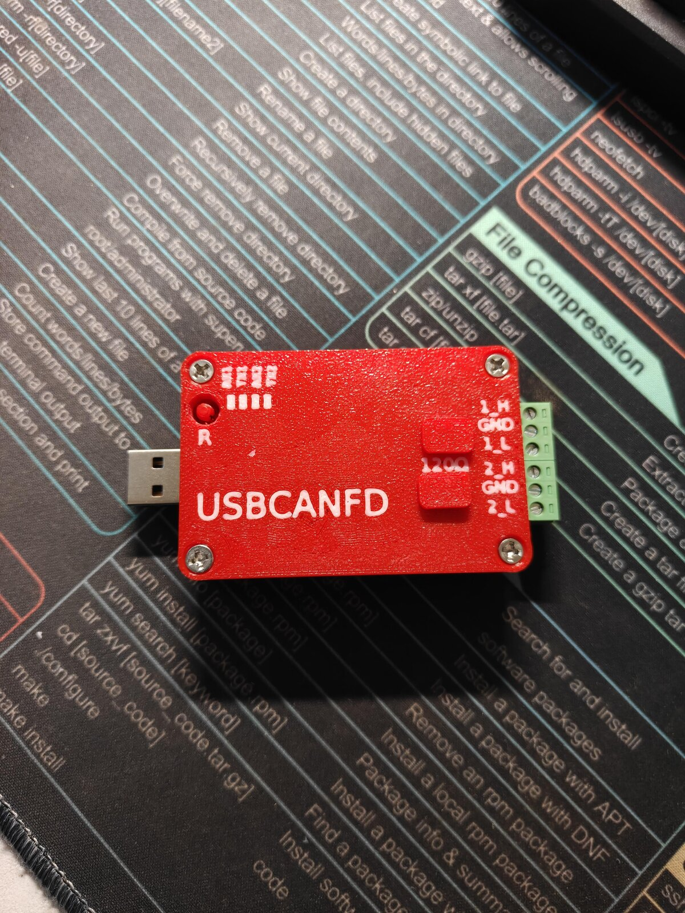 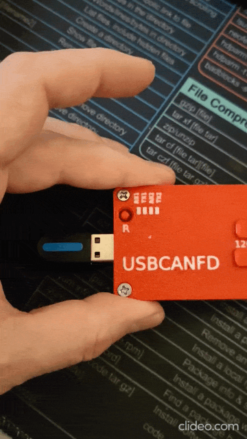

## Features

| | |
|---|---|
| Fastening | 4 × M3 countersunk screws (DIN 7991 M3×14) into 4 × brass heat-set inserts M3×5×4 in the bottom part. Heads sit flush with the lid |
| Status LEDs | Light pipes above **RX1 TX1 RX2 TX2**, closed by thin white membranes printed into the lid |
| Reset button | Captive plunger in a guide shaft, marked **R**. A snap barb stops it from falling out; the cap sits recessed in a well so it is not pressed by accident |
| 120 Ω termination | Two windows above the termination jumpers. Each window is closed by a **jumper holder** that grips the jumper cap: pull the holder by its rim and the jumper comes out with it (termination off); push it back to switch termination on. An empty holder just closes the window |
| Labels | White inlay in the red lid: LED names, **R**, **120Ω**, terminal pinout **1_H GND 1_L / 2_H GND 2_L**, **USBCANFD** |
| USB | The USB-A plug sticks out ~12.9 mm (1.6 mm end wall), so it goes fully into a PC port |
| CAN terminals | The CAN end of the case is flush with the front of the screw terminals |
| Size | 68.1 × 45.5 × 19.0 mm |

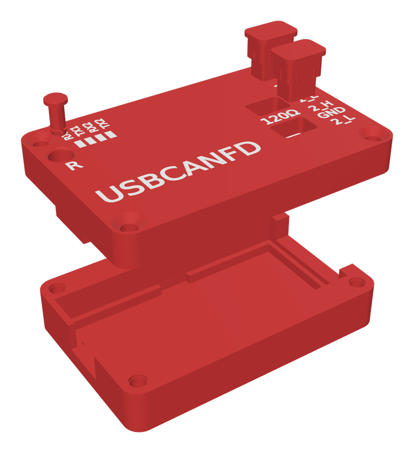 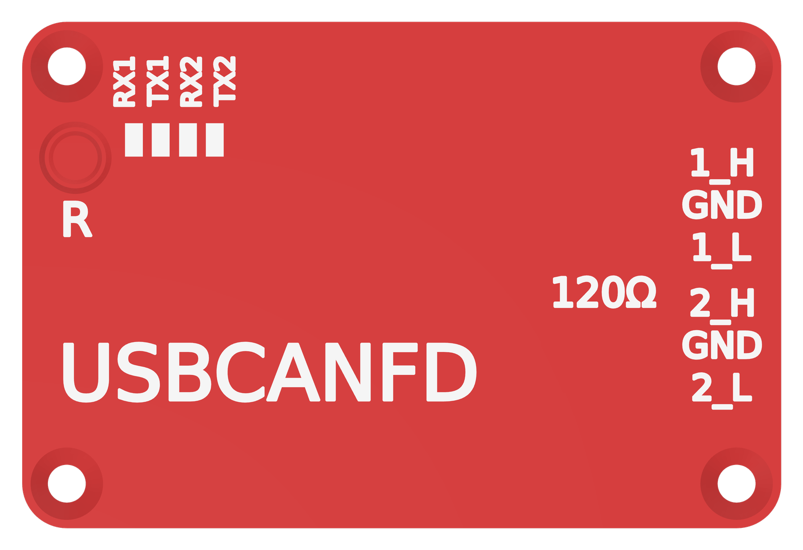

## Bill of materials

| Qty | Part |
|---:|---|
| 1 | USBCANFD DUAL PCB |
| 4 | Brass heat-set insert **M3×5×4** (5 mm overall height, Ø4.0 mm maximum outside diameter; [AliExpress](https://www.aliexpress.com/item/1005009537259422.html)) |
| 4 | Countersunk screw **DIN 7991 / ISO 10642 M3×14** |
| 1 | Printed bottom |
| 1 | Printed lid (two colours) |
| 1 | Printed button plunger (the print plate has 2, one is spare) |
| 2 | Printed jumper holders |

For these **M3×5×4** inserts, **M3** is the thread size (0.5 mm pitch), **5** is the overall height in mm, and **4** is the maximum outside diameter in mm. The upper end has an outside diameter of **3.7 mm**.

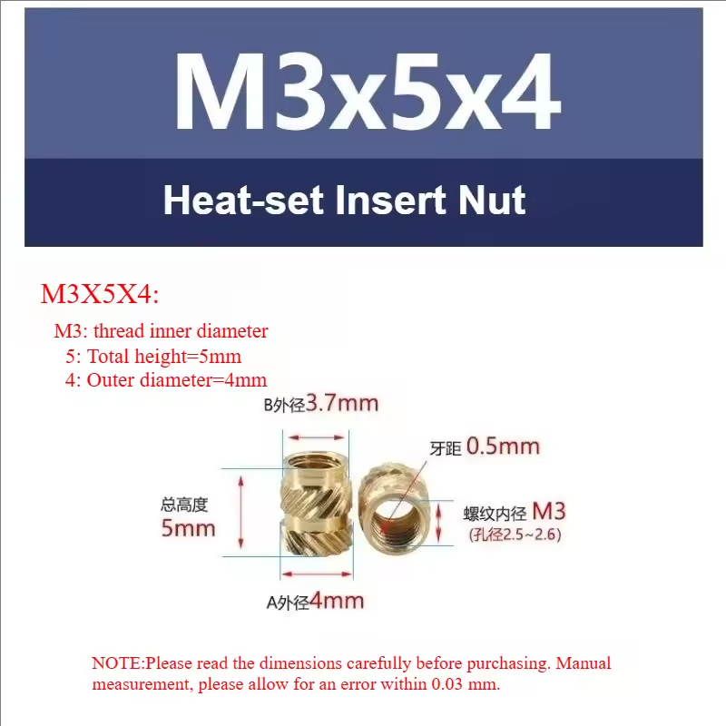

## Printing

Everything fits on one plate. **No supports** are needed.

- **Material:** PETG. The original was printed in red PETG with a white PETG inlay.
- **Process:** 0.2 mm layers, 3 walls; top and bottom surface pattern **concentric**.
- **Lid:** printed **roof down**. The white inlay (labels and LED membranes) is the first 3 layers (0.6 mm), so only 2 filament changes are needed.
- **Single-colour print:** assign the inlay part to the same filament as the body. Do not leave the inlay out: it also forms the LED membranes, and without it the LED windows stay open.
- **Plunger:** printed cap down. **Jumper holders:** printed rim down.
- **Heat-set insert pockets:** Ø3.6 mm with a Ø4.0 × 0.6 mm lead-in, 6 mm deep. They are tuned for a slicer with **XY hole compensation 0**. If your inserts sit loose or too tight, adjust `INSERT_HOLE_D` in the script.

Bambu Studio files (printer: Bambu Lab P2S 0.4; filament 1 red, filament 2 white):

| File | |
|---|---|
| [`bambu_studio/USBCANFD_DUAL_M3_NUT.3mf`](bambu_studio/USBCANFD_DUAL_M3_NUT.3mf) | Project with all parts on one plate. Open it and switch the printer profile if you have a different printer |
| [`bambu_studio/USBCANFD_DUAL_M3_NUT_P2S.gcode.3mf`](bambu_studio/USBCANFD_DUAL_M3_NUT_P2S.gcode.3mf) | Sliced for **P2S only** (~70 min, 24 g red + 1 g white) |

For other slicers use the STL files. Import `USBCANFD_DUAL_M3_NUT_Top_body_print.stl` and `USBCANFD_DUAL_M3_NUT_Top_inlay_print.stl` **together as one multi-part object** (they share the same origin), and assign the white filament to the inlay.

## Assembly

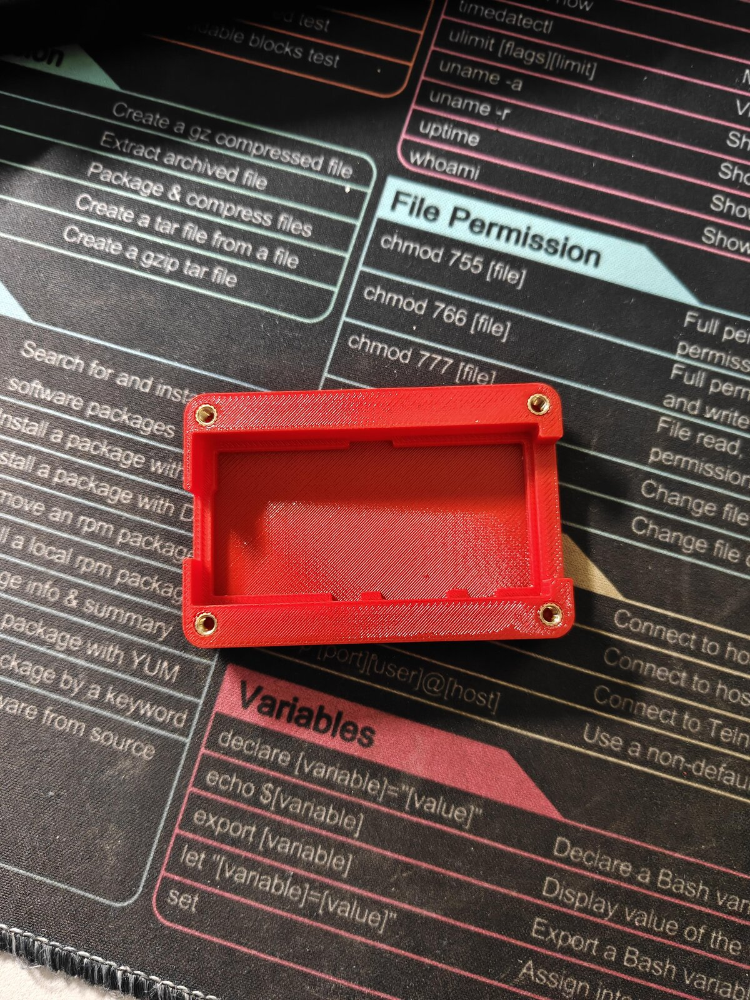 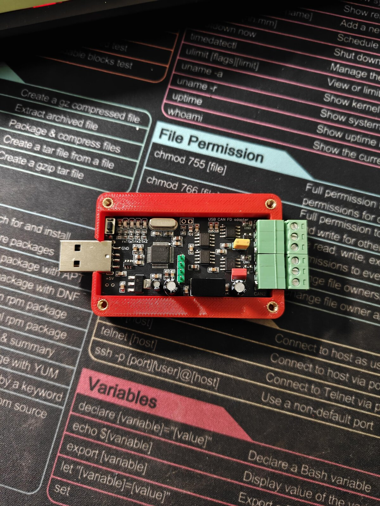 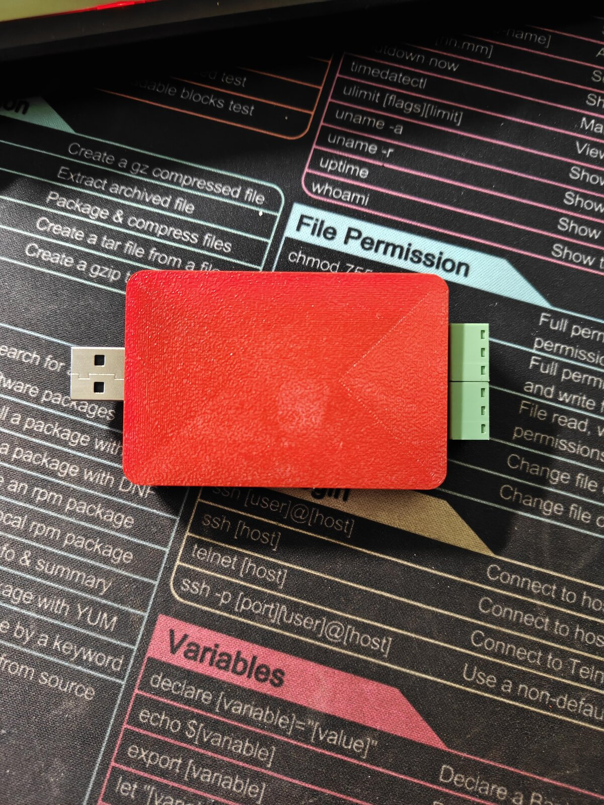

1. Melt the 4 heat-set inserts into the bottom part from the top (parting-line) side, flush with the surface.
2. Put the PCB into the bottom part. The USB plug goes through the end wall, and the screw terminals sit in the opposite cut-out.
3. Push the plunger into the button shaft from the outside of the lid until the barb snaps through.
4. Put the lid on and fasten it with the 4 countersunk screws.
5. Termination: press a jumper cap into a holder, then push the holder into the window above the jumper pins. To remove the jumper, pull the holder out by its rim.

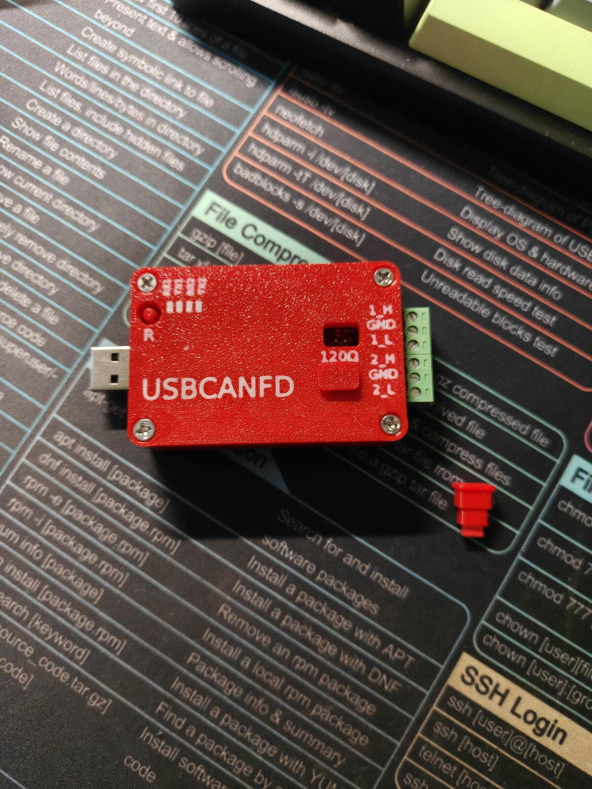

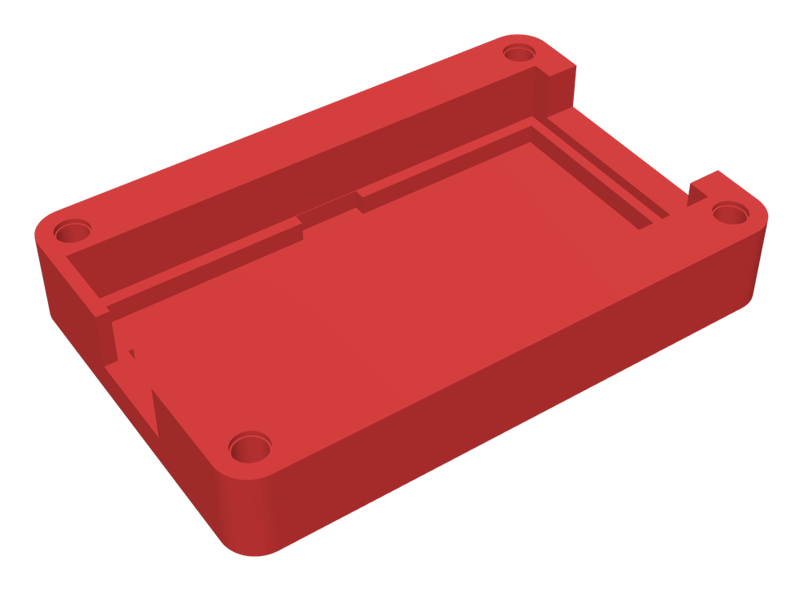 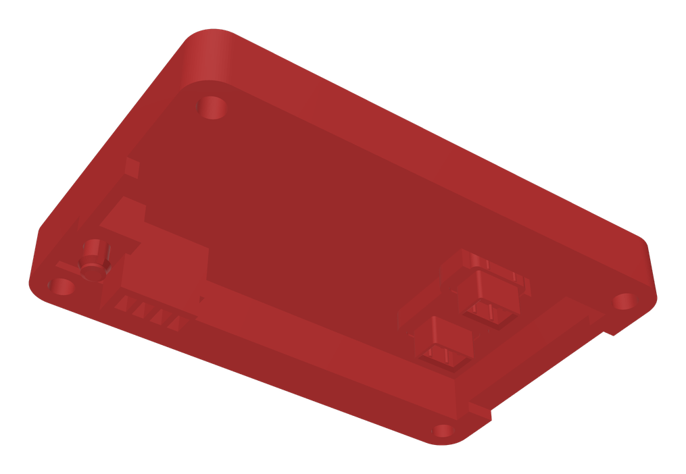

## Files

| Folder | Content |
|---|---|
| [`stl/`](stl/) | Print-ready meshes: `Bottom`, `Top_body_print` + `Top_inlay_print` (two-colour lid), `Button`, `JumperHolder` |
| [`step/`](step/) | STEP of every part (`Top` = lid as one solid) and `Assembly.step` |
| [`freecad/`](freecad/) | `USBCANFD_DUAL_M3_NUT.FCStd`: the assembly in FreeCAD |
| [`bambu_studio/`](bambu_studio/) | Bambu Studio project and P2S sliced file |
| [`source/`](source/) | `build_cannectivity_case.py`, the generator of all files above |
| [`../../img/`](../../img/) | Photos and renders |

GitHub shows the `.stl` files as interactive 3D models: open any file in [`stl/`](stl/) to rotate it in the browser.

## Rebuilding from source

All dimensions are constants at the top of the script, for example PCB clearance, insert pocket, screw countersink, label sizes and jumper-holder grip. The script needs FreeCAD 1.x (tested with 1.1) and the DejaVu Sans font. If the font is elsewhere on your system, adjust `FONT`.

```bash
freecadcmd /absolute/path/to/build_cannectivity_case.py
# Flatpak FreeCAD:
flatpak run --command=/app/bin/freecadcmd org.freecad.FreeCAD "$PWD/build_cannectivity_case.py"
# output to another folder:
CANNECTIVITY_OUT=/some/dir freecadcmd "$PWD/build_cannectivity_case.py"
```

The script checks that every part is one valid solid, that the parts do not collide in the assembly, and that the plunger has free travel. It writes STL, STEP and FCStd files next to itself (or to `CANNECTIVITY_OUT`). The Bambu Studio projects are made from these STL files.
